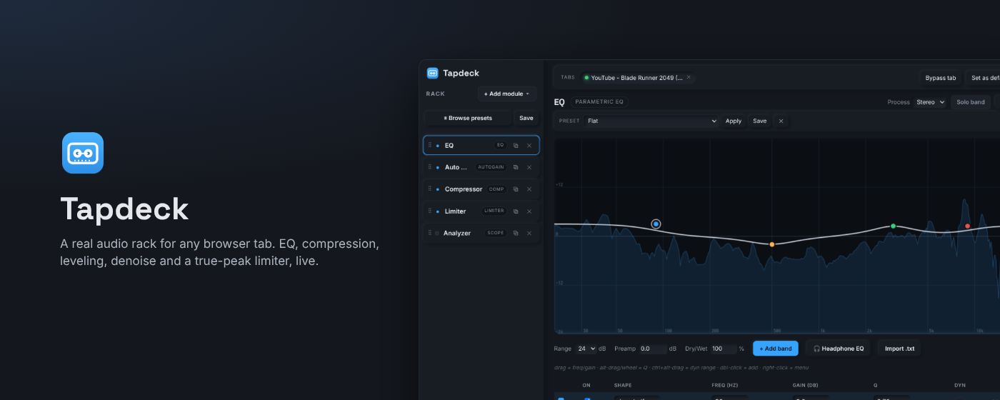
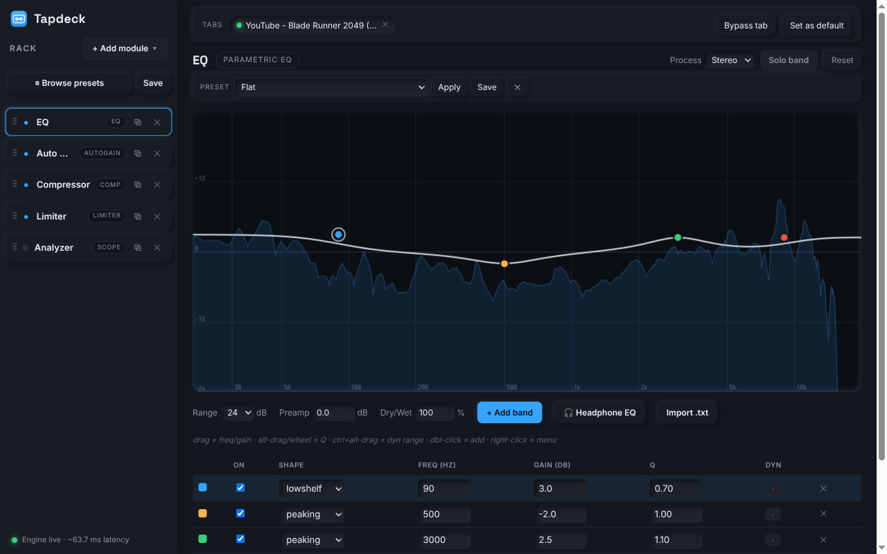
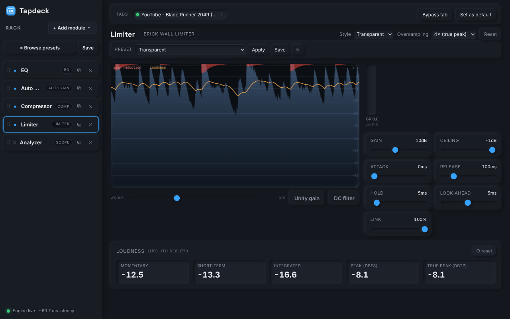
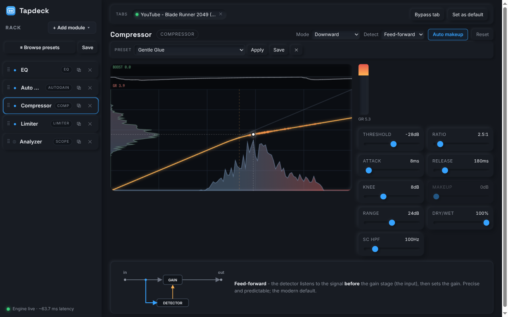
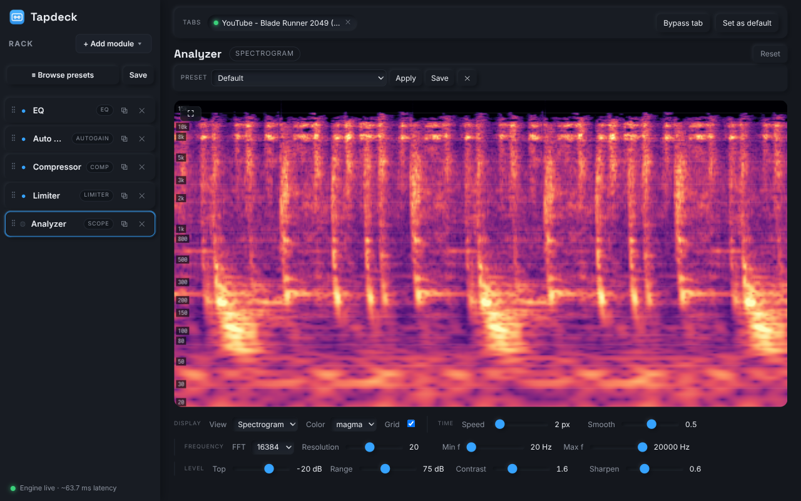
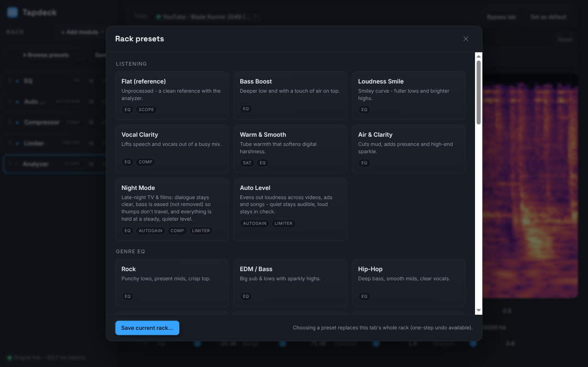
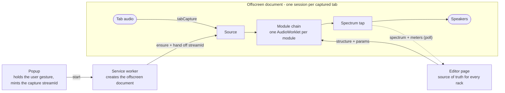

<p align="center">
  
</p>

<h1 align="center">Tapdeck</h1>

<p align="center">
  A real audio processing rack for any browser tab.<br>
  Parametric EQ, compression, multiband, gating, auto-leveling, denoise, de-reverb, saturation and a true-peak limiter,<br>
  all running inside the extension with live visualization.
</p>

<p align="center">
  <a href="https://github.com/RAOEUS/tapdeck/actions/workflows/ci.yml"></a>
  <a href="LICENSE"></a>
  
  
  
</p>

---

## Contents

- [Why](#why)
- [Screenshots](#screenshots)
- [Modules](#modules)
- [Presets](#presets)
- [Install](#install)
- [Usage](#usage)
- [Architecture](#architecture)
- [Development](#development)
- [Packaging for the Chrome Web Store](#packaging-for-the-chrome-web-store)
- [Privacy](#privacy)
- [Known limitations](#known-limitations)
- [License](#license)

## Why

Browser audio is where most people listen now, and it has no processing at all. Films where the dialogue is quiet and the explosions aren't. Calls where one person is twice as loud as the next. Podcasts with hiss and room echo. Headphones that need a correction curve.

Tapdeck captures a tab's audio and runs it through a chain you build, in any order, before it reaches your speakers. No companion app, no virtual audio device, no system routing. Each tab gets its own independent rack, so a film in one tab and a call in another can be processed differently at the same time.

## Screenshots

<table>
  <tr>
    <td width="50%"><br><sub><b>Parametric EQ.</b> Drag bands on a live spectrum. Per-band dynamics, mid/side, band solo, AutoEq headphone correction.</sub></td>
    <td width="50%"><br><sub><b>Limiter.</b> Look-ahead brick wall with true-peak detection, scrolling gain-reduction display and BS.1770 loudness meters.</sub></td>
  </tr>
  <tr>
    <td width="50%"><br><sub><b>Compressor.</b> Transfer curve with the live operating point, input and output level histograms, gain-over-time strip.</sub></td>
    <td width="50%"><br><sub><b>Analyzer.</b> Multi-resolution constant-Q spectrogram, or a 3D waterfall.</sub></td>
  </tr>
  <tr>
    <td colspan="2"><br><sub><b>Preset browser.</b> Categorized rack presets for listening, film, games, voice, calls, mastering and effects, plus your own saved racks.</sub></td>
  </tr>
</table>

## Modules

| Module | What it does |
|---|---|
| **EQ** | Multi-band parametric (8 shapes, up to 48 dB/oct passes), optional per-band **dynamics** (cut, boost, lift-when-quiet, OTT), **Stereo / Mid / Side** processing, **band solo**, dry/wet, and one-click **AutoEq headphone correction** from a searchable library. |
| **Compressor** | Down / Up / Expand / OTT modes, soft knee, feed-forward or feed-back detection, parallel mix, side-chain high-pass, auto makeup. |
| **Multiband** | Linkwitz-Riley split into up to 8 bands with a full compressor per band, OTT-capable, phase-aligned reconstruction. |
| **Gate / Expander** | Threshold, ratio, range, attack, release and hold, with a live open/closed display. |
| **Auto Gain** | Loudness leveler. Rides a slow gain to hold a target LUFS, with a gate, a range limit, a settle-in phase that locks on within about a second, and a built-in brick wall so boosts never clip. |
| **Denoise** | Spectral noise suppressor (minimum statistics + Wiener gate). 0% is bit-transparent. |
| **De-reverb** | STFT decay expander that pulls down reverb tails while passing transients and sustained notes. Can analyze the room and set itself. |
| **Transient** | Attack and sustain envelope shaping. |
| **Saturator** | Tube, tape, crunch, fold and hard waveshapers with 2x/4x oversampling. |
| **Limiter** | Look-ahead brick wall with attack, hold and channel link, oversampled true-peak detection, four styles, unity-gain match, DC filter, and momentary / short-term / integrated LUFS with the BS.1770 relative gate. |
| **Utility** | Gain, balance, width, mono, channel invert and swap, headphone crossfeed, goniometer and correlation meter. |
| **Analyzer** | Multi-resolution constant-Q spectrogram and 3D waterfall. |

Every module has built-in presets and lets you save your own.

## Presets

Rack presets replace the whole chain in one click and are grouped by purpose:

- **Listening**: Flat (reference), Bass Boost, Loudness Smile, Vocal Clarity, Warm & Smooth, Air & Clarity, Night Mode, Auto Level
- **Movies & Games**: Movie / TV, Dialogue Clarity, Gaming, Laptop Speakers
- **Voice & Podcast**: Podcast Voice, Clean Voice, De-ess & Polish, Broadcast
- **Calls & Streaming**: Noise Kill, Meeting Voice, Stream Master
- **Mastering**: Master Bus, Mastering (MB), Loud Master, Transparent Master
- **Creative / FX**: OTT, Lo-Fi, Telephone, Saturated Drive, Wide & Big, Mono Check
- **Genre EQ**: Rock, EDM / Bass, Hip-Hop, Classical, Jazz, Acoustic, Vocal Boost

The leveling presets (Movie / TV, Night Mode, Auto Level, Meeting Voice and friends) run the Auto Gain first so the compressor and limiter after it work at fixed, predictable thresholds whatever the source level. The film and game presets keep the sub intact.

## Install

**From the Chrome Web Store**: coming soon.

**Unpacked**, for development or if you'd rather not use the store:

1. Clone or download this repository.
2. Open `chrome://extensions`, turn on **Developer mode**, click **Load unpacked** and pick the folder.

Works in any Chromium browser (Chrome, Edge, Brave, Vivaldi, Opera). Chrome 116 or newer is required.

## Usage

1. Open a tab that's playing audio.
2. Click the **Tapdeck** toolbar icon, then **Start on this tab**.
3. Click **Open Rack & Visualizer** to build the chain: **+ Add module** or **Browse presets**, drag to reorder, click the dot to bypass a module.
4. **Set as default** makes the current rack the starting point for every newly captured tab.

The popup also has a master bypass and an output trim for quick A/B without opening the editor.

Keyboard shortcuts in the editor: `Ctrl+Z` / `Ctrl+Y` undo and redo, `Ctrl+D` duplicate, `Ctrl+C` / `Ctrl+V` copy and paste a module (across tabs too), `Delete` removes the selected module while the rack list has focus, double-click a name to rename it.

## Architecture



- **Engine** (`offscreen.js`): one independent session per captured tab with its own `AudioContext`, capture stream, ordered rack and analyser. Rebuilds the node graph on any structural change; runs the spectrogram STFT on its own thread, off the audio thread.
- **Editor** (`editor.html`, `editor.js`, `editor-renderers.js`, `editor-helpers.js`): source of truth for all rack state. Pushes structure and params to the engine and polls it for visualization.
- **DSP** (`worklet/*.js`): one `AudioWorkletProcessor` per module on the audio thread, built on a shared base class and DSP library (`worklet/dsp-shared.js`).
- **Registry** (`module-registry.js`): the single list of modules that the engine's worklet table, the add menu, the rack tags and the editor dispatch are all derived from.
- **Shared math** (`dsp-math.js`): biquad design and magnitude response, reused by the editor so the drawn curve matches the sound. A test guards that the formulas are identical.

Manifest V3 forces this split. Service workers can't host an `AudioContext`, so audio lives in an offscreen document, and the popup mints the capture `streamId` because `tabCapture` needs a live user gesture that doesn't survive the hop to the worker.

## Development

There is no build step. After editing source, reload the extension card in `chrome://extensions`. Worklet and engine changes also need the tab re-captured, since the `AudioContext` is built at capture time.

```
npm test          # browser-free DSP + editor tests (node --test)
npm run check     # syntax-check every shipped JS file
```

The DSP tests drive each `AudioWorkletProcessor`'s `process()` directly in a Node `vm` and assert real properties: the limiter holds the ceiling and the true peak, denoise at 0% is transparent, the gate gates, saturator oversampling reduces aliasing, EQ solo of a flat band is silent, the expander opens at attack speed, the integrated LUFS applies the relative gate, the auto-gain settles within a second, and the drawn EQ curve matches the worklet's filter. An editor smoke test loads every page script into a DOM stub and renders every module.

CI runs both on every push.

## Packaging for the Chrome Web Store

```
npm run pack
```

Produces `tapdeck-<version>.zip` with `manifest.json` at the root and only the shipped files inside. Listing assets (screenshots and promo tiles at the store's required sizes) are in [`docs/store/`](docs/store/).

## Privacy

Nothing is collected, stored remotely, or transmitted. Audio is processed in your browser and never recorded. Settings live in `chrome.storage.local`. The only network request is fetching a headphone profile from the public [AutoEq](https://github.com/jaakkopasanen/AutoEq) repository when you use **Headphone EQ**, and no user data is sent with it. There is no remote code.

## Known limitations

- **Chrome and Chromium only.** Firefox has no `tabCapture` API or offscreen documents, so there is no way to get at a tab's audio from an extension there.
- **DRM audio** (some Netflix / Spotify players) can't be captured.
- Browsers allow around six concurrent `AudioContext`s, so about six tabs can be processed at once.
- Latency is a few milliseconds plus any limiter look-ahead and the 8 ms frame delay of Denoise and De-reverb. Fine for playback, not for live monitoring.

## License

MIT. See [LICENSE](LICENSE).
